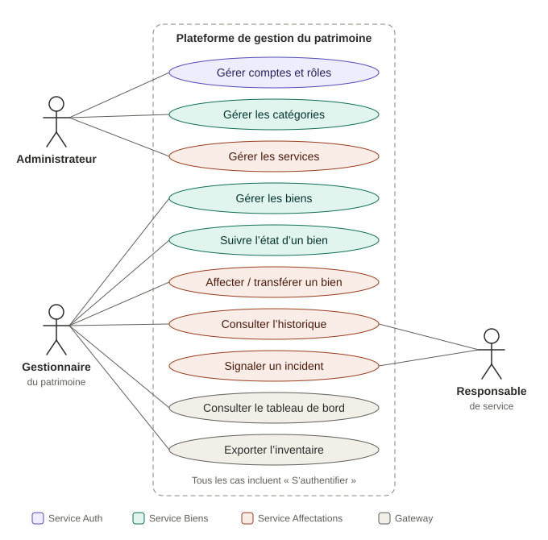
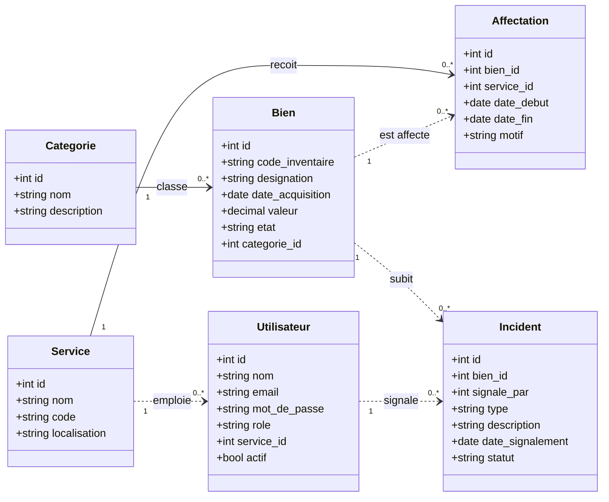
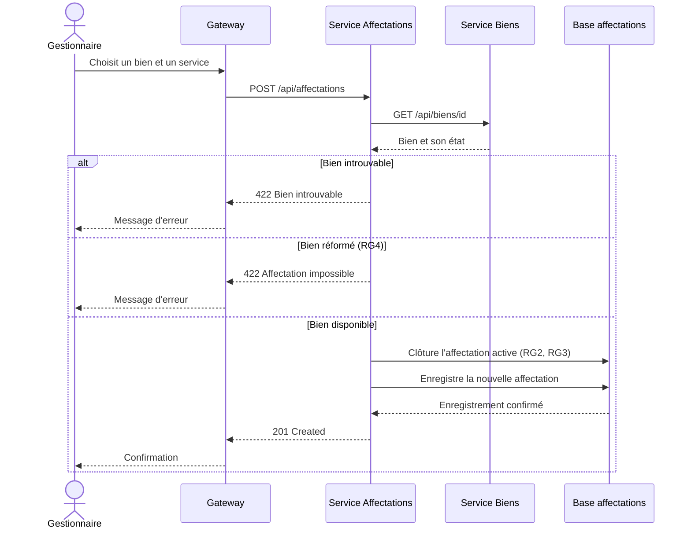
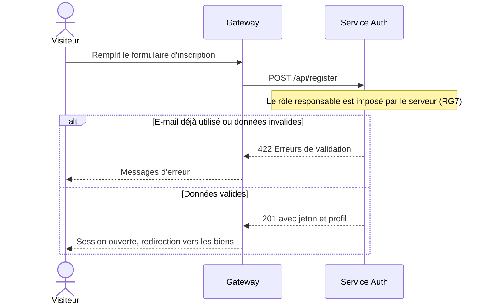

# Conception UML

## Diagramme de cas d'utilisation

Quatre acteurs, treize cas d'utilisation, colorés selon le micro-service qui les réalise.

## Diagramme de classes

Les traits pleins relient des classes d'un même service. Les traits pointillés
sont des références par identifiant entre services (pas de clé étrangère
entre bases différentes).

## Diagramme de séquence : affecter un bien à un service

## Diagramme de séquence : créer un compte

