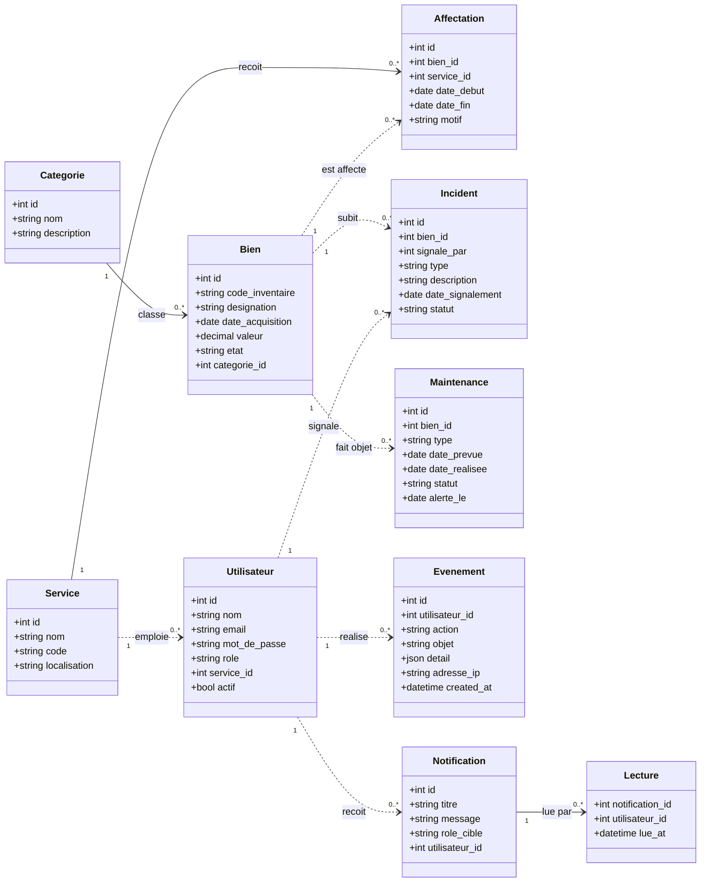
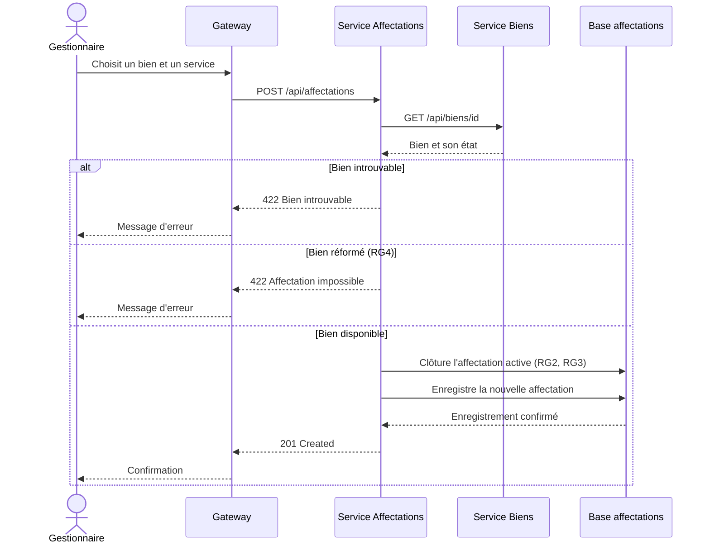
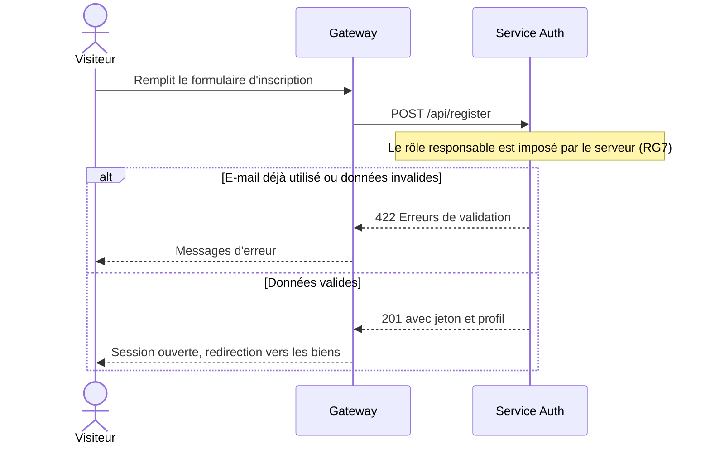
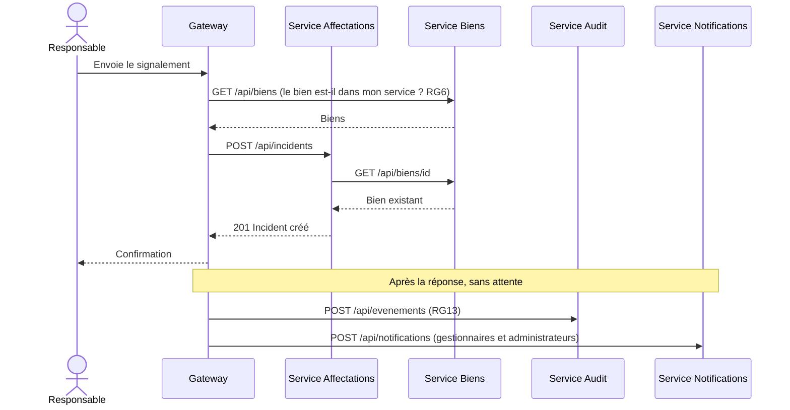
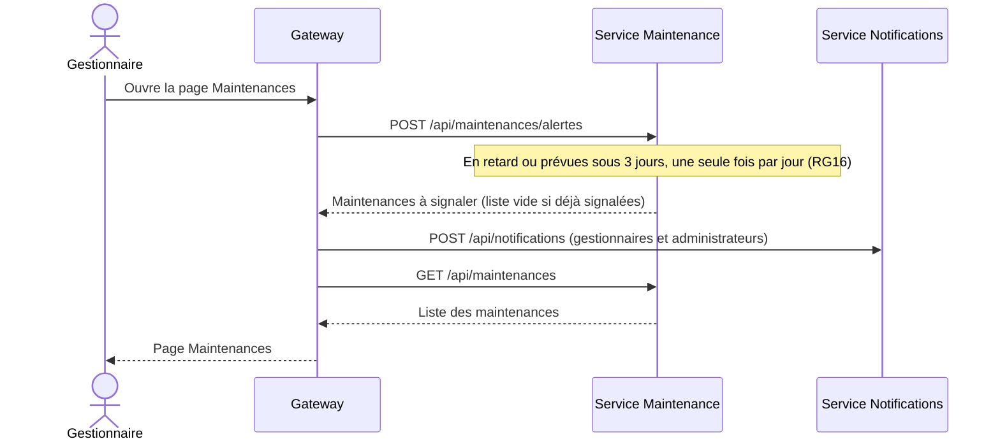

# Conception UML

## Diagramme de cas d'utilisation

Quatre acteurs, seize cas d'utilisation, colorés selon le micro-service qui les réalise.

## Diagramme de classes

Les traits pleins relient des classes d'un même service. Les traits pointillés
sont des références par identifiant entre services (pas de clé étrangère
entre bases différentes).

## Diagramme de séquence : affecter un bien à un service

## Diagramme de séquence : créer un compte

## Diagramme de séquence : signaler un incident (journal et notifications)

Le journal et les notifications sont envoyés après la réponse, avec un délai
d'attente de 2 secondes : leur panne ne bloque jamais l'utilisateur.

## Diagramme de séquence : alertes de maintenance

